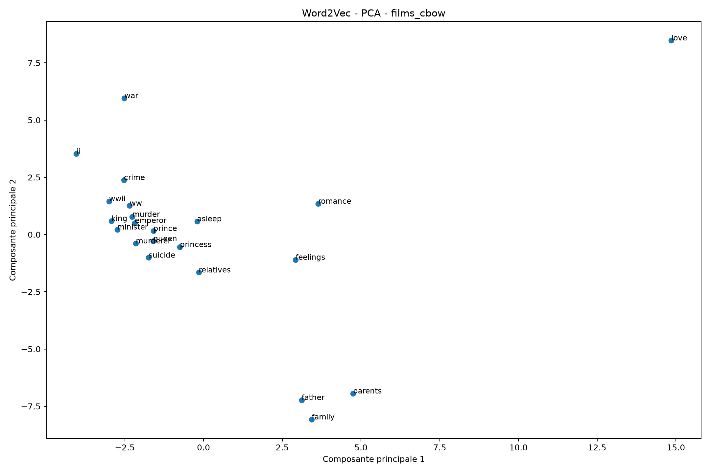
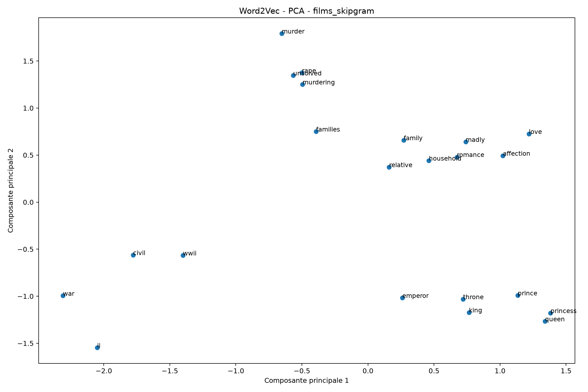
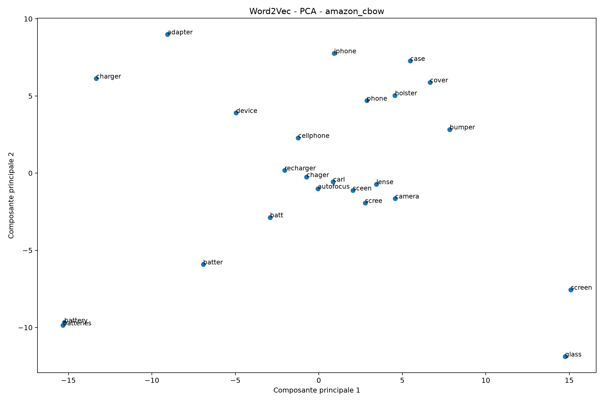
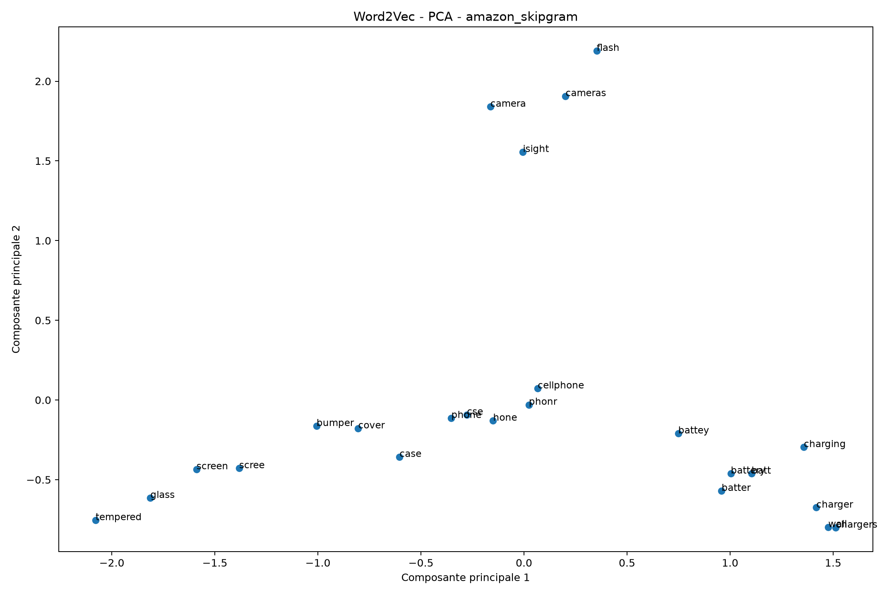
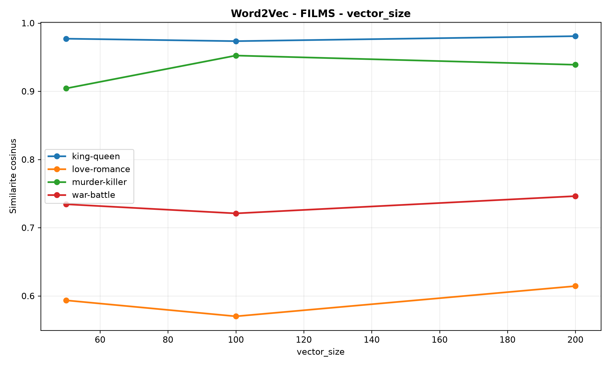
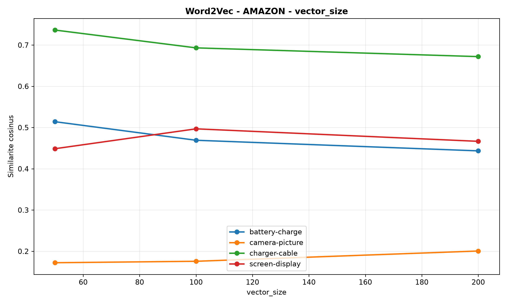
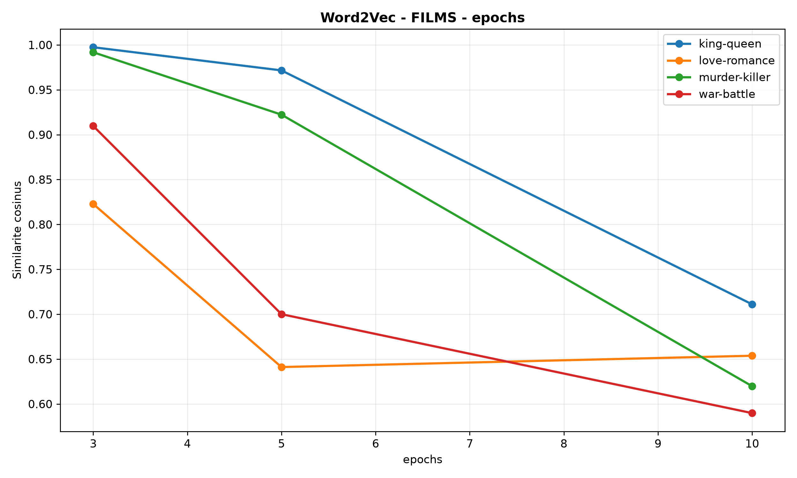
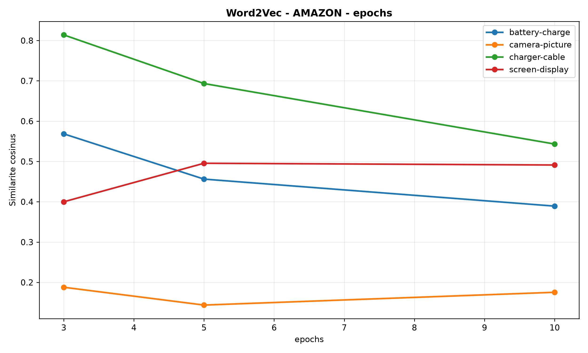

# Word2Vec NLP Analysis — CBOW vs Skip-gram

   

> **From raw text to semantic embeddings:** train and compare four Word2Vec models on movie plot summaries and Amazon product reviews.

## Project overview

This project explores **Word2Vec**, a neural word-embedding method that learns vector representations of words from their surrounding context. It compares **Continuous Bag of Words (CBOW)** and **Skip-gram** on two different text domains:

- **Movies:** plot overviews from `movies_metadata.csv`.
- **Amazon:** product reviews from the *Cell Phones and Accessories* review dataset.

The project covers preprocessing, model training, cosine-similarity evaluation, nearest-neighbor inspection, PCA visualization, and hyperparameter experiments.

## Pipeline

`Raw text → Tokenization → CBOW / Skip-gram training → Similarity evaluation → PCA → Hyperparameter analysis`

## Model comparison

| Architecture | Training objective | Practical trade-off |
|---|---|---|
| **CBOW** | Predict a target word from nearby context words | Faster training in these experiments |
| **Skip-gram** | Predict surrounding words from a target word | Slower training in these experiments |

**Baseline configuration:** 100-dimensional embeddings · context window 5 · minimum word count 5 · 5 epochs · seed 42 · up to 4 workers.

### Recorded training results

| Dataset | Architecture | Vocabulary | Training time |
|---|---|---:|---:|
| Movies | CBOW | 22,475 | 6.40 s |
| Movies | Skip-gram | 22,475 | 19.13 s |
| Amazon | CBOW | 32,764 | 140.01 s |
| Amazon | Skip-gram | 32,764 | 426.09 s |

*These are recorded runs, not hardware-independent benchmarks. Training time depends on the execution environment.*

## Semantic evaluation

The evaluation script computes **cosine similarity** for selected word pairs and extracts the **10 nearest neighbors** of chosen words.

Example evaluation pairs:

| Movies | Amazon |
|---|---|
| king / queen | battery / charge |
| love / romance | screen / display |
| war / battle | camera / picture |
| murder / killer | charger / cable |

Cosine similarity measures vector proximity; a high score is **not** by itself proof of semantic correctness. Results should be interpreted in context.

### Embedding visualizations

| Movies — CBOW | Movies — Skip-gram |
|---|---|
|  |  |

| Amazon — CBOW | Amazon — Skip-gram |
|---|---|
|  |  |

The PCA plots project selected 100-dimensional word vectors into two dimensions for qualitative inspection. Distances in the 2D projection are only an approximation of the original embedding space.

## Hyperparameter experiments

The additional experiments vary one parameter at a time using **CBOW** and sampled corpora (up to **10,000 movie summaries** and **30,000 Amazon reviews**). These are separate from the full-corpus baseline models.

| Parameter | Tested values |
|---|---|
| Vector size | 50, 100, 200 |
| Context window | 2, 5, 10 |
| Epochs | 3, 5, 10 |

The experiment script uses `min_count=3`, unlike the baseline's `min_count=5`. Therefore, these tests should not be treated as a controlled comparison against the baseline training table.

**Sample hyperparameter plots**

| Movies | Amazon |
|---|---|
|  |  |
|  |  |

See [all hyperparameter results](results/hyperparameters_results.csv), [training measurements](results/training_results.csv), [pairwise similarities](results/similarites.csv), and [nearest neighbors](results/mots_similaires.csv).

## Repository structure

```text
Word2Vec-NLP-Analysis/
├── scripts/
│   ├── 01_preprocessing.py
│   ├── 02_train_word2vec.py
│   ├── 03_evaluation.py
│   ├── 04_beautiful_graphs.py
│   └── 05_hyperparameters.py
├── results/
│   ├── training_results.csv
│   ├── hyperparameters_results.csv
│   ├── similarites.csv
│   ├── mots_similaires.csv
│   ├── pca_*.png
│   └── hyper_*.png
├── .gitignore
└── [project report].pdf
```

**Note:** Raw datasets, generated token files and trained `.model` artifacts are not currently included in this repository. The scripts train and save the models locally; the published CSVs and figures document the recorded experiments.

## Run locally

1. Clone the repository and enter its directory.
2. Create and activate a Python virtual environment.
3. Install dependencies:

```bash
pip install pandas numpy gensim matplotlib scikit-learn
```

4. Create a `data/` directory and provide the compatible source files:
   - `data/movies_metadata.csv` containing an `overview` column.
   - `data/Cell_Phones_and_Accessories_5.json` (or one of the `.json.gz` filenames supported by the preprocessing script), with JSON-lines records containing `reviewText`.

5. Run the scripts in order:

```bash
python scripts/01_preprocessing.py
python scripts/02_train_word2vec.py
python scripts/03_evaluation.py
python scripts/04_beautiful_graphs.py
python scripts/05_hyperparameters.py
```

The preprocessing step writes tokenized corpora to `results/`; training saves four model files under `models/`. Actual results may vary by dataset version and execution environment.

## Key takeaways

- Word2Vec learns **domain-specific** word representations: movie plots and product reviews produce different vocabularies and relationships.
- CBOW trained substantially faster than Skip-gram in the recorded runs.
- Similarity scores and PCA plots provide **exploratory, qualitative** evidence rather than a standardized accuracy metric.
- Changing embedding size, window and epochs affects similarity behavior and runtime; there is no universally optimal setting from these experiments alone.

## Technical stack

**Python · Gensim · Pandas · NumPy · scikit-learn · Matplotlib · NLP · Word Embeddings**

## Project report

The full academic report (PDF) is available in the repository root.

---

**Author:** [NacPKZ](https://github.com/NacPKZ) · Data & AI portfolio project
